# Locating bacterial flagellar motors in cryo-electron tomograms

Team project at TU Dresden (2026) by Leonid Dybovskii, [Diliara Sharipova](https://github.com/D1L-R) and [Kaster Kumarbek](https://github.com/KasterEd), based on the Kaggle competition [BYU – Locating Bacterial Flagellar Motors 2025](https://www.kaggle.com/competitions/byu-locating-bacterial-flagellar-motors-2025). We trained and evaluated two heatmap U-Nets (in a 2D and a 3D variant), as well as two object detectors, YOLOv8n and RT-DETR-l.

## Task

The task is to locate bacterial flagellar motors in cryo-electron tomograms of whole cells. Each tomogram is a stack of several hundred grayscale slices and may contain no motor, one or several; for each motor, its center (z, y, x) has to be predicted. The task is difficult because the motors are small, have low contrast and resemble other structures of the cell envelope.

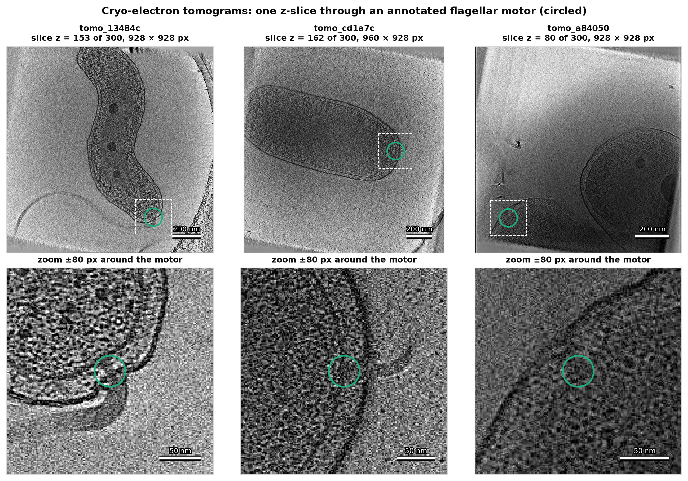

## Data

The competition provides 648 labeled tomograms with 451 motors; 286 tomograms contain no motor. Each tomogram is a stack of 300 to 800 slices, and the voxel size ranges from 6.5 to 19.7 Å. The tomograms are split at random into 519 training and 129 validation tomograms with 357 and 94 motors. Since the Kaggle test tomograms are unlabeled, all results refer to the validation tomograms. The data is not part of this repository and can be obtained from the competition page.

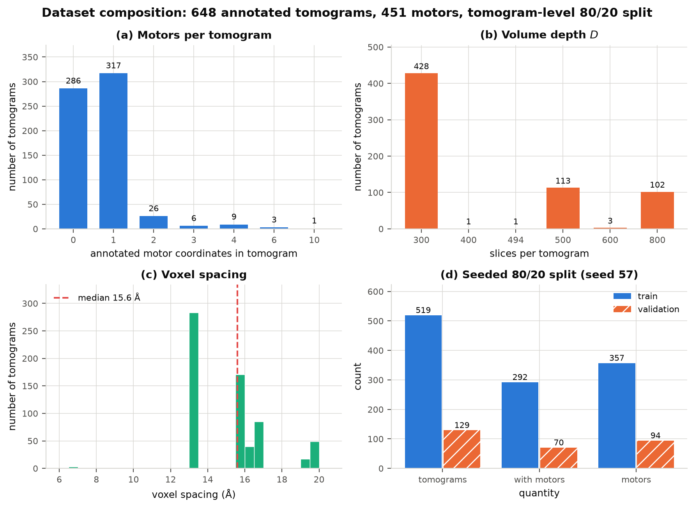

## Evaluation

U-Nets and detectors predict motors in different ways. A U-Net gives every voxel of the tomogram a motor probability. A detector draws boxes on single slices and gives each box a confidence. For the detectors, these confidences are written at the box centers into a 3D array of the size of the tomogram, and all other voxels are set to 0. All four models are thus evaluated on the same kind of output, a score volume that assigns every voxel a value between 0 and 1.

Next, predicted positions are extracted from the score volumes. A voxel becomes a position if its score exceeds a score threshold (we tried 0.05 to 0.9) and is the highest within 9 voxels in every direction (3D non-maximum suppression). Thus, a motor detected on several neighboring slices gives only one position.

The predicted positions are then compared with the annotated motors. Each position is paired with at most one motor by the Hungarian algorithm [1], which finds the pairing with the smallest total distance; pairs farther apart than 1000 Å are not allowed. A motor that receives a position counts as found (true positive, TP), a motor without one as missed (false negative, FN), and a position without a motor as a false positive (FP). The counts over all validation tomograms are combined into the F2 score of the competition, which weighs a missed motor four times as much as a false positive. Each model is reported at the score threshold with the highest F2.

## Models

**U-Nets** [2] return an image of the same size as their input, here a heatmap of how likely each pixel is to be a motor center. The training target is calculated as a heatmap with a small Gaussian peak at each motor center and zeros elsewhere (for U-Net 2D, on every slice within ±3 of the center). Both U-Nets are built with MONAI [3] and trained from scratch.
- **U-Net 2D** processes single slices in 512 × 512 pixel crops.
- **U-Net 3D** processes 64 × 64 × 64 voxel subvolumes and can therefore use information along z.

<p align="center">
  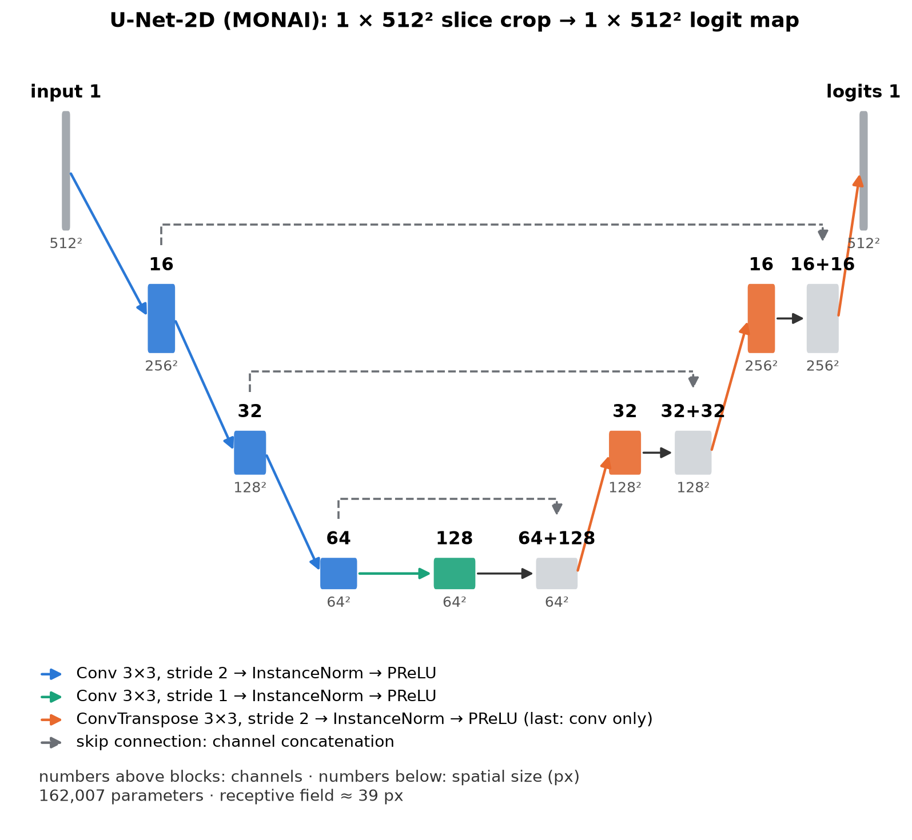
  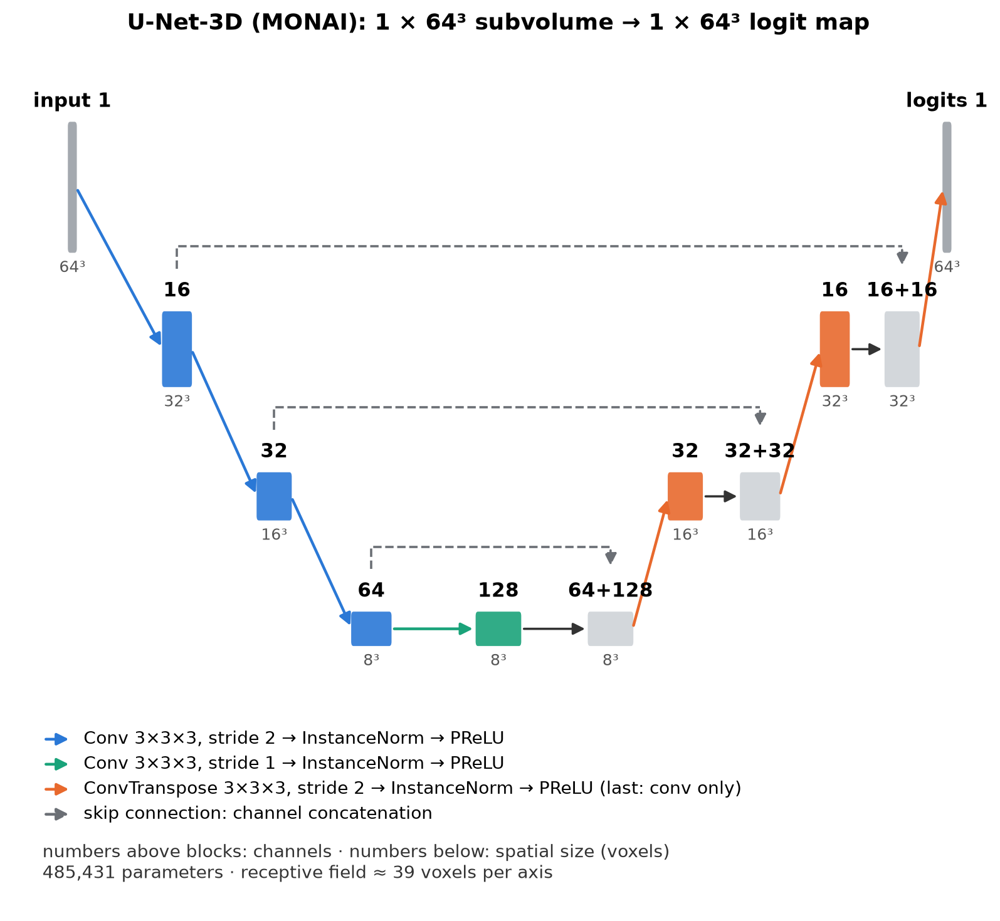
</p>

**Object detectors** predict boxes on 2D tiles of 640 × 640 pixels. Both are trained with Ultralytics [4], starting from weights pretrained on the COCO dataset [5]; the center of each box is taken as the motor position. In both, a convolutional network shrinks the tile step by step into three grids with cells of 8, 16 and 32 pixels (80 × 80, 40 × 40 and 20 × 20 cells, 8,400 in total). The two detectors differ in how they turn these cells into boxes.
- **YOLOv8n** (3.0 M parameters) predicts one box with a confidence for every cell. A motor is therefore covered by several overlapping boxes, and a non-maximum suppression removes most of them, keeping the most confident one.
- **RT-DETR-l** [6] (32.8 M parameters) first applies self-attention to the coarsest grid (20 × 20), so that each cell receives information from the whole tile. A classification layer then rates every cell of the three grids by how likely it is to contain a motor. The 300 highest-rated cells become object queries, and a transformer decoder refines each query into one box with a confidence. During training, each motor is assigned to exactly one query, so the model learns to predict a single box per motor.

<p align="center">
  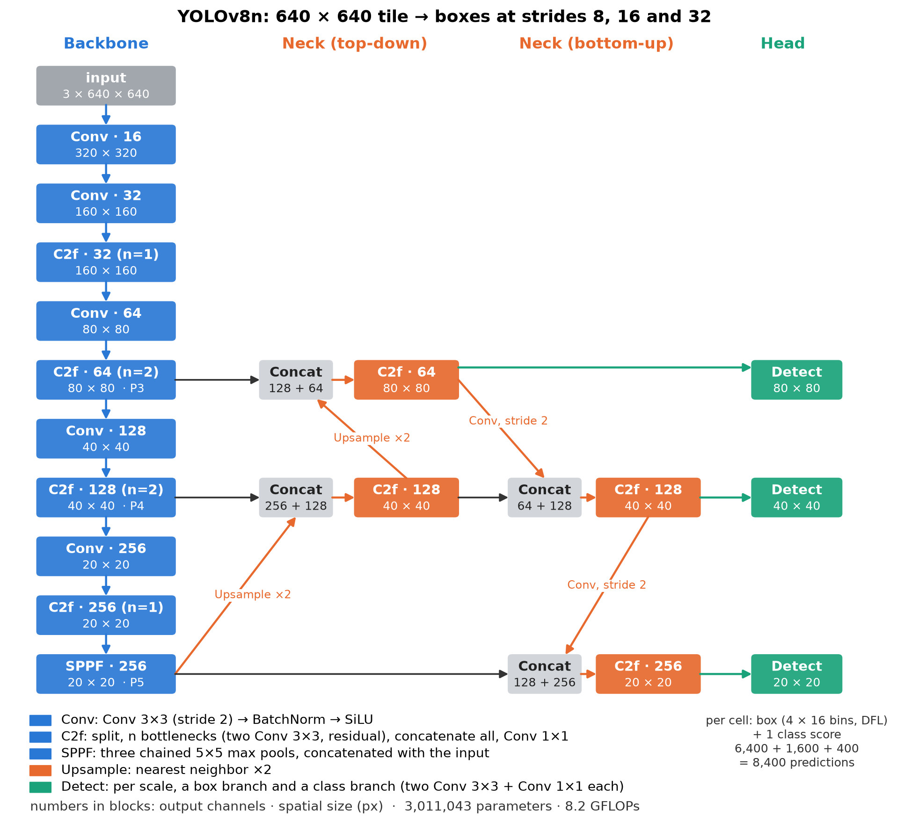
  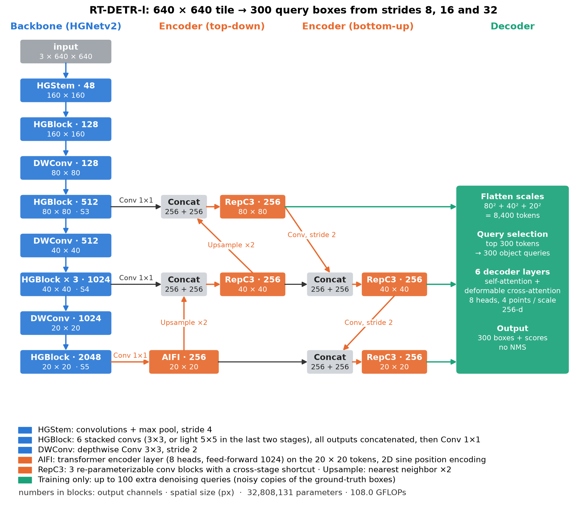
</p>

## Training

Motors fill only a tiny part of a tomogram, so a model trained on randomly chosen crops would see almost no motors To tackle this calss imbalance, we fixed the ratio of positive and negative samples.

**U-Nets.** For every motor, we drew 100 random positive crops that contain it, so that the motor appears at different positions in the crop; for U-Net 2D, a crop contains a motor if its slice lies within ±3 of the motor center. For every motor, we also drew 1100 negative crops without a motor, and each tomogram without a motor contributes the average number of negatives. About 5 % of all crops are therefore positive. Half of the negatives come from random positions, half from near a motor; these hard negatives are more likely to contain motor-like structures. For data augmentation, we flipped the crops and rotated them by multiples of 90°. Within a crop, almost all voxels are background, so predicting 0 everywhere already gives a small squared error. We therefore used the focal loss of CenterNet [7, 8], which down-weights background voxels that are already predicted correctly.

```math
L = -\frac{1}{N_{\text{pos}}} \sum_i \begin{cases} (1-p_i)^2 \log p_i & \text{if } y_i = 1 \\ (1-y_i)^4 \, p_i^2 \log(1-p_i) & \text{otherwise} \end{cases}
```

Here $p_i$ is the predicted probability of voxel $i$, $y_i$ its target and $N_{\text{pos}}$ the number of motor centers in the batch. The factor $p_i^2$ down-weights background voxels already predicted near 0, $(1-y_i)^4$ softens the penalty close to a motor center, and dividing by $N_{\text{pos}}$ counts the loss per motor rather than per voxel.

We trained U-Net 2D for 40 epochs and U-Net 3D for 20, and kept the checkpoint with the best F2 on the validation tomograms.

**Detectors.** We labeled each motor with a 19 × 19 pixel ground-truth box around its center. A motor is visible on several slices, so we placed this box on every slice within ±3 of the center. We used all positive tiles and 282 negative tiles per motor, so about 1.4 % of the training tiles are positive. For data augmentation, the tiles were flipped, scaled, shifted and changed in brightness and color at random; YOLOv8n also used mosaic augmentation [9] in all but the last 10 epochs: four tiles are placed around a random point on an image of twice the tile size, which is then cropped back to 640 × 640 pixels, so motors appear at different positions and may be cut off. During training, label assignment decides which cells or queries should output each ground-truth box: in YOLOv8n the 10 cells whose boxes fit it best [10], in RT-DETR-l one query. The loss moves their boxes onto the ground-truth box and raises their confidence the more the boxes overlap. All other cells or queries, the large majority of the 8,400 cells in YOLOv8n or 300 queries in RT-DETR-l, learn a confidence of 0. We trained both detectors for 20 epochs. For both, we kept the Ultralytics default: the checkpoint with the best mAP50–95 on the validation tiles, not the one with the best F2.

All models were trained on four NVIDIA A100 GPUs of the Alpha Centauri cluster at TU Dresden.

## Inference

Each model scans a tomogram tile by tile. The U-Nets use non-overlapping tiles of the training size (512 × 512 pixels per slice, or 64³ voxels), each normalized separately and padded with zeros at the tomogram border. The detectors cut every slice, as in training, into 640 × 640 pixel tiles laid edge to edge from its corner, with border tiles padded with zeros, and keep boxes with a confidence of at least 0.05. The tile predictions of a tomogram are then combined into its score volume.

## Ablations

To find out how individual parts of the pipelines affect the results, we took the four models above as baselines and changed one component at a time while keeping everything else the same. These ablations were:
- **Stitching** (all models, no retraining). The tomogram is cut into tiles that overlap by half, and the predictions of overlapping tiles are combined, so that every voxel is also seen away from a tile edge.
- **MSE** (U-Nets, retrained). The focal loss is replaced by the plain mean squared error.
- **Connected components** (U-Nets, no retraining). Positions are extracted differently: touching voxels above the score threshold form one region, and each region gives one position at its maximum.
- **Center slice** (YOLOv8n, retrained). Each motor is labeled only on its center slice instead of on every slice within ±3 of it.

## Results

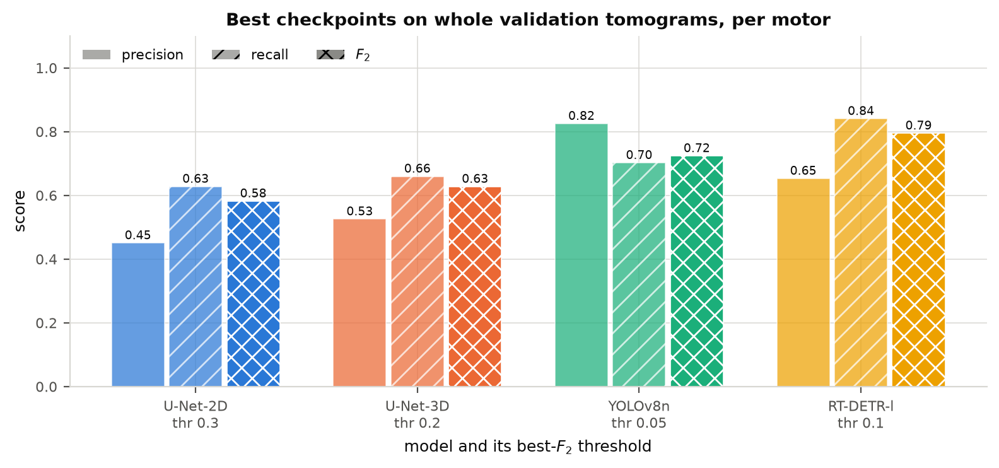

| Model | Variant | Threshold | F2 | Precision | Recall | TP (of 94) | FP |
|---|---|---|---|---|---|---|---|
| U-Net 2D | Baseline | 0.3 | 0.582 | 0.450 | 0.628 | 59 | 72 |
|  | Stitching | 0.3 | 0.652 | 0.663 | 0.649 | 61 | 31 |
|  | MSE | 0.6 | 0.570 | 0.596 | 0.564 | 53 | 36 |
|  | Connected components | 0.3 | 0.540 | 0.347 | 0.628 | 59 | 111 |
| U-Net 3D | Baseline | 0.2 | 0.628 | 0.525 | 0.660 | 62 | 56 |
|  | Stitching | 0.1 | 0.726 | 0.423 | 0.883 | 83 | 113 |
|  | MSE | 0.4 | 0.653 | 0.670 | 0.649 | 61 | 30 |
|  | Connected components | 0.2 | 0.608 | 0.463 | 0.660 | 62 | 72 |
| YOLOv8n | Baseline | 0.05 | 0.724 | 0.825 | 0.702 | 66 | 14 |
|  | Stitching | 0.1 | 0.771 | 0.897 | 0.745 | 70 | 8 |
|  | Center slice | 0.05 | 0.000 | 0.000 | 0.000 | 0 | 3616 |
| RT-DETR-l | Baseline | 0.1 | 0.795 | 0.653 | 0.840 | 79 | 42 |
|  | Stitching | 0.2 | 0.803 | 0.824 | 0.798 | 75 | 16 |

- **Baselines.** RT-DETR-l reached the highest F2 and recall, followed by YOLOv8n, U-Net 3D and U-Net 2D. YOLOv8n had the fewest false positives.
- **Stitching** improved all four models, the U-Nets most. For the U-Nets, it removed most false positives at a fixed threshold. For U-Net 3D, the best threshold dropped to 0.1, where U-Net 3D found 83 of the 94 motors, but also 113 false positives. For the detectors, stitching found more motors at a fixed threshold, and the best threshold moved up, where precision was higher. YOLOv8n gained in both precision and recall. RT-DETR-l gained least: its precision rose, but its recall fell, so its F2 barely changed.
- **MSE.** Both U-Nets trained with MSE loss had higher precision but lower recall, and their best thresholds were two times higher than those of the focal-loss baselines.
- **Connected components.** Both U-Nets found the same motors as their baselines at every threshold, but more false positives, which lowered precision.
- **Center slice.** YOLOv8n trained on center-slice labels found no motor at any threshold. It still produced false positives at low thresholds (3,616 at 0.05) and none from 0.4 on.

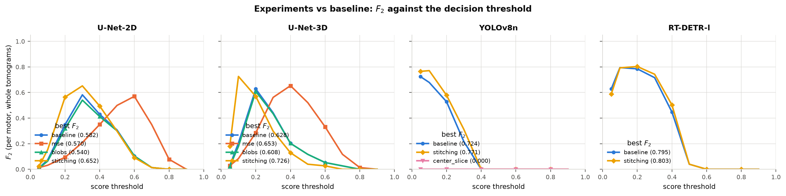

## Findings

**Tile borders in U-Net 3D.** Stitching improved U-Net 3D the most. At the baseline threshold, it removed 51 of its 56 false positives, about half of which lay within 2 voxels of a tile face. One possible explanation is the small receptive field: each U-Net output depends on an input window of only 39 pixels, about 610 Å at the median voxel size. Near a tile border, part of this window falls outside the tile and sees zeros. In the 64³ tiles of U-Net 3D, only 6.7 % of the voxels see their full window, against 86 % in the 512 × 512 tiles of U-Net 2D. This would explain why stitching helped U-Net 3D the most. Averaging the overlapping tiles also lowered the scores at the motors, which is why the best threshold of the stitched U-Net 3D dropped to 0.1.

**Occlusion sensitivity.** To see which part of the input the U-Nets use, we covered a 16 × 16 pixel square of the input (a 16³ cube for U-Net 3D) with the mean intensity, moved it in steps of 8 pixels and recorded how much the predicted probability at the motor dropped [11]. The maps below show two examples of a map for a motor in 2D and 3D. 

<p align="center">
  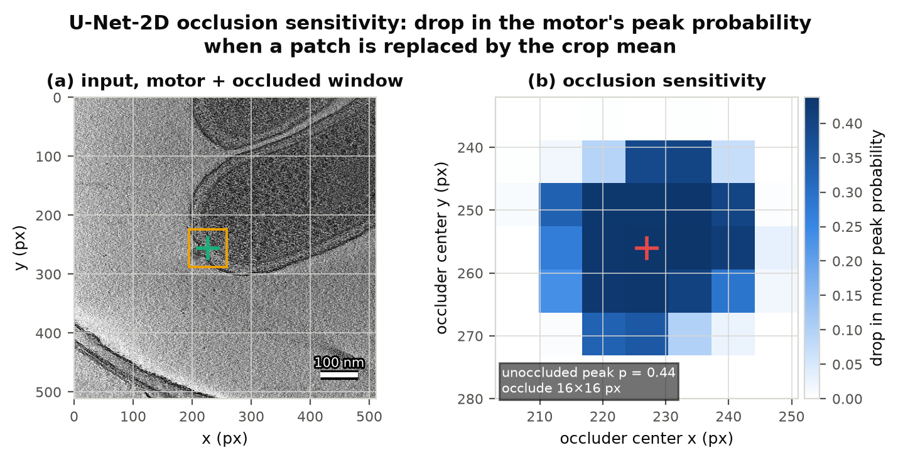
  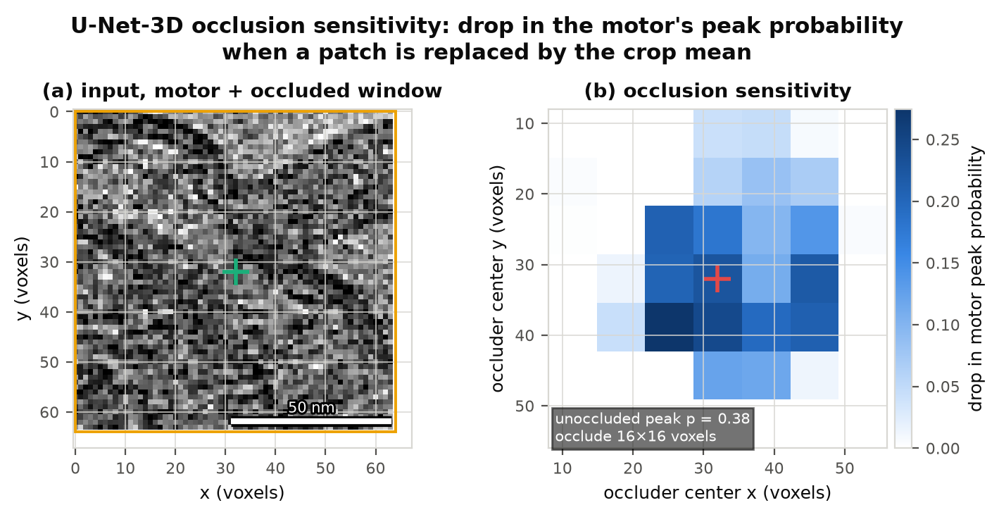
</p>

**Complementary errors.** The models missed different motors: 82 of the 94 motors were found by at least one baseline, but only 41 by all four. A combination of the models could therefore find more motors than any single one.

**Checkpoint selection for YOLOv8n.** YOLOv8n reached its best F2 (0.742) in epoch 11, but the checkpoint kept by mAP50–95 was from the last epoch. mAP50–95 kept rising until the last epoch, but YOLOv8n found fewer motors: 66 against 68 in epoch 11. This could happen if the later epochs mainly made the boxes tighter, which mAP50–95 rewards, while F2 only counts whether a motor is found within 1000 Å. Picking by F2 would have kept epoch 11.

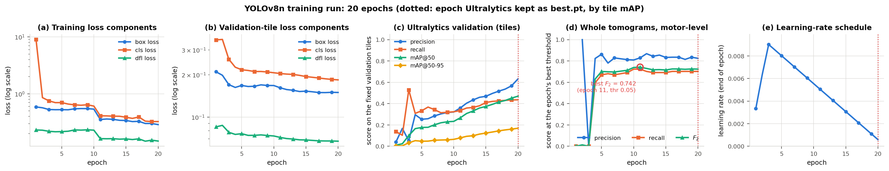

**Validation loss of U-Net 3D.** For U-Net 3D, the validation loss and F2 rose together during training, so the epoch with the lowest validation loss was an early one with a low F2. A likely reason is that almost no validation tile contains a motor, so the validation loss mostly measures the background. It rose as the network became more confident on motor-like structures in the background, which does not change F2 as long as these structures stay below the score threshold. The validation loss is therefore not a suitable criterion for choosing the U-Net checkpoint; F2, which we used, measures detection directly.

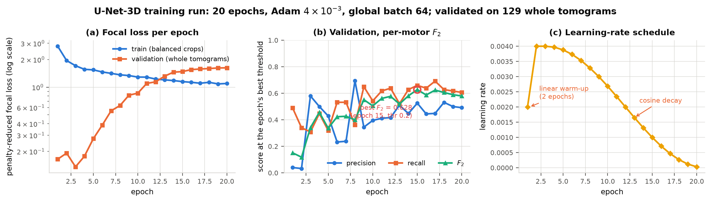

**First-epoch loss of U-Net 2D.** In the first epoch, the training loss of U-Net 2D was about 10,000 times higher than later. U-Net 2D started with outputs near 0.5 for every pixel, so each of the millions of background pixels in a batch added to the loss; U-Net 3D, whose outputs started at 0.01, showed no such jump. The high first-epoch loss therefore reflects the initialization, not a problem with training.

**MSE.** The U-Nets trained with MSE did not collapse to predicting 0 everywhere, although almost all target voxels are 0. A likely reason is that the balanced sampling already removed most of the imbalance. Their scores at motors were about twice as high as with the focal loss, which explains their two times higher best thresholds. Their F2 was close to that of the focal-loss baselines, so with balanced sampling, the focal loss seems to matter less than expected.

**Duplicate boxes of RT-DETR-l.** RT-DETR-l found more motors, but YOLOv8n had the higher mAP50 (0.470 against 0.215). Within a tile, RT-DETR-l outputs several shifted boxes per motor, YOLOv8n one or two. These additional boxes presumably lower the mAP50 of RT-DETR-l, while the 3D non-maximum suppression merges them before F2 is computed. mAP50 therefore underrates RT-DETR-l for locating motors.

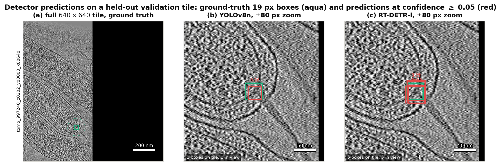

**Connected components.** Connected components often gave one motor several positions instead of one. The first counted as a found motor, the others as false positives, so precision fell while recall stayed the same. A likely reason is that the area above the threshold around a motor can break into separate pieces, and each piece gets its own position; the 9-voxel window of the non-maximum suppression keeps only the strongest of them.

**Center slice.** YOLOv8n trained with ground-truth boxes on the center slice only, instead of ±3 slices, detected no motor. After the first epoch, all its training losses and tile metrics rounded to 0. Each motor gave one positive slice instead of seven, so the training set had both fewer motor examples and a lower share of them; the experiment cannot tell which of the two made YOLOv8n fail.

**float16 checkpoints of RT-DETR-l.** An earlier RT-DETR-l run saved its checkpoints in float16, the Ultralytics default. Some BatchNorm variances exceeded the largest float16 value (65,504) and were clipped when saved. BatchNorm divides each channel by the square root of its variance, so the model loaded from these checkpoints for evaluation left the clipped channels too large. It produced confident boxes almost everywhere: about 1.37 million false positives at a recall of 0.99. We therefore saved the checkpoints of the final run in float32.

**NaN losses of RT-DETR-l.** In the final run, the losses of RT-DETR-l became NaN in two epochs. In these epochs, the model produced no valid boxes, so its tile metrics dropped to 0, and Ultralytics resumed training from the last checkpoint with finite weights. The cause is unknown. One hypothesis would be an overflow of the BatchNorm variances: training still ran in mixed precision, partly with 16-bit numbers, whose largest value is 65,504, and variances above this limit could turn the loss into NaN. However, the variances stayed above the limit after the resumption, and no further NaN losses occurred, so this explanation is unlikely.

## Conclusion

The pretrained detectors located motors more reliably than the U-Nets trained from scratch. A likely reason is the small context of the U-Nets: each U-Net output depends on a window of only 39 pixels around it, and in the 64³ tiles of U-Net 3D, the tile borders cut this window short for most voxels. When overlapping tiles reduced this problem, U-Net 3D reached the F2 of the YOLOv8n baseline (0.726 against 0.724).

These results have several limitations:
- The models differ not only in architecture but also in pretraining, sampling of training crops, augmentation, number of epochs, optimizer and numerical precision at inference (bfloat16 for U-Net 2D, float32 for U-Net 3D, float16 for the detectors), so the ranking compares complete pipelines.
- Epochs, thresholds and scores were all selected on the same 129 validation tomograms, so the results are optimistic; no separate test set was used.
- With only 94 validation motors, recall has a standard error of about 0.04–0.05, roughly 4 motors, so differences of a few motors between models may be due to chance.
- The voxel size was not normalized, so the same motor can appear three times larger in one tomogram than in another, and the 9-voxel window of the non-maximum suppression covers 58.5 to 177 Å. The pairing limit of 1000 Å, several times the size of a motor, makes F2 measure detection rather than exact localization.
- The best threshold of YOLOv8n was the lowest one tried (0.05), and boxes below this confidence were discarded. Its F2 may therefore be underestimated: a lower threshold might have found more motors.

Next steps would be to train all models with the same ratio of empty to motor samples, the same augmentation and the same rule for choosing the checkpoint, so that differences in the results come from the models themselves. Each part of the pipeline, such as the labels along z, the sampling, the augmentation, the loss and the tiling, should then be changed one at a time and evaluated on a separate test set. For the U-Nets, a larger receptive field should be tried first.

## References

1. H. W. Kuhn. The Hungarian method for the assignment problem. *Naval Research Logistics Quarterly*, 2(1–2):83–97, 1955. https://doi.org/10.1002/nav.3800020109
2. O. Ronneberger, P. Fischer, T. Brox. U-Net: Convolutional networks for biomedical image segmentation. *MICCAI*, 2015. https://doi.org/10.1007/978-3-319-24574-4_28
3. M. J. Cardoso et al. MONAI: An open-source framework for deep learning in healthcare. arXiv:2211.02701, 2022. https://arxiv.org/abs/2211.02701
4. G. Jocher, J. Qiu, A. Chaurasia. Ultralytics YOLO. Software, 2023. https://github.com/ultralytics/ultralytics
5. T.-Y. Lin et al. Microsoft COCO: Common objects in context. *ECCV*, 2014. https://doi.org/10.1007/978-3-319-10602-1_48
6. Y. Zhao et al. DETRs beat YOLOs on real-time object detection. *CVPR*, 2024. https://doi.org/10.1109/CVPR52733.2024.01605
7. X. Zhou, D. Wang, P. Krähenbühl. Objects as points. arXiv:1904.07850, 2019. https://arxiv.org/abs/1904.07850
8. T.-Y. Lin, P. Goyal, R. Girshick, K. He, P. Dollár. Focal loss for dense object detection. *ICCV*, 2017. https://doi.org/10.1109/ICCV.2017.324
9. A. Bochkovskiy, C.-Y. Wang, H.-Y. M. Liao. YOLOv4: Optimal speed and accuracy of object detection. arXiv:2004.10934, 2020. https://arxiv.org/abs/2004.10934
10. C. Feng, Y. Zhong, Y. Gao, M. R. Scott, W. Huang. TOOD: Task-aligned one-stage object detection. *ICCV*, 2021. https://doi.org/10.1109/ICCV48922.2021.00349
11. M. D. Zeiler, R. Fergus. Visualizing and understanding convolutional networks. *ECCV*, 2014. https://doi.org/10.1007/978-3-319-10590-1_53
